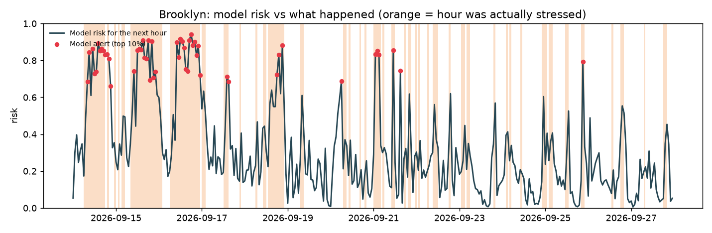

# RescueNYC: an early-warning radar for NYC ambulance dispatch

> **In one sentence:** every hour, for each NYC borough, we predict whether 911 medical calls are
> about to wait unusually long for an ambulance, and tell the supervisor where and why.

[中文版在下面 ↓](#中文版)

---

## Our conclusions

1. **Watch the queue, not just the phone.** How many calls are *waiting* for an ambulance right now
   predicts trouble much better than how many calls are *coming in*.
2. **When it raises an alarm, it is usually right:** about **7 out of 10** times, with only about
   **4 false alarms a day** across all of NYC. It beats every simple method we tried.
3. **It is a radar, not a crystal ball.** It is good at spotting trouble, judging that it will last,
   and explaining why. It is **not** good at seeing a brand-new problem coming an hour early.

## Runs on IBM LinuxONE

The whole pipeline runs on our IBM LinuxONE server (IBM Z, `s390x`): it loads 6 million calls,
trains the model and the 4 simple methods, and runs the exam. Results match the laptop run:

| | Laptop (arm64) | **IBM LinuxONE (s390x)** |
|---|---|---|
| Our model's score | 0.597 | **0.596** |
| Alarms that were right | 68% | **68%** |
| Time for the whole pipeline | 23 s | **56 s** |
| Peak memory | – | about 4 GB |

Server output: [`results_linuxone/results.md`](results_linuxone/results.md).

## Why this is useful

- **For a dispatch supervisor:** instead of scanning dozens of numbers, they get one ranked list
  every hour: *"Brooklyn 90%: 53 low-priority calls on hold, waits 5.7x normal."* They know where to
  look first and why. They still decide what to do.
- **For NYC:** FDNY is planning a new EMS dispatch system. This shows an add-on that only reads
  events the system already records (call created, ambulance assigned, arrived, at hospital). It
  changes nothing in how calls are handled and needs no patient details.
- **For the project:** it is a real finding on 6 million real calls, tested honestly on months the
  model never saw.

---

## The problem, in plain words

When you call 911 for a medical emergency in NYC:

```
you call  →  an ambulance is assigned  →  it drives to you  →  hospital
             ▲
             └── if no ambulance is free, your call is put "on hold" and waits
```

FDNY sends ambulances to the most serious calls first. When there aren't enough free ambulances,
less serious calls get put on hold, and their wait jumps **from about 20 seconds to over 8 minutes**
(real medians: 23 s vs 506 s). About 1 in 5 calls was put on hold at some point.

We want to warn a supervisor **before** that backlog builds up.

## The data

The public FDNY record of **every 911 medical call**, 6 million calls from January 2023 to
September 2026 ([NYC Open Data](https://data.cityofnewyork.us/Public-Safety/EMS-Incident-Dispatch-Data/76xm-jjuj)).
Each call has the time it came in, when an ambulance was assigned, when it arrived, how serious it
was (1 = most critical … 8 = least), the borough, and whether it was put on hold.

## What counts as "stressed"

We compare each borough with **its own normal for that hour of the week**:

> An hour is **stressed** if less serious calls waited much longer than usual for that borough at
> that time: the typical (median) wait is higher than 80% of the same hour over the past 8 weeks.

Real example, Brooklyn on Friday nights 8–9 pm:

| Friday | Typical wait that hour | "Usual" limit (from the past 8 Fridays) | Stressed? |
|---|---|---|---|
| Sep 11, 2026 | 115 seconds | 168 seconds | No |
| Sep 18, 2026 | **889 seconds** (~15 min) | 128 seconds | **Yes** |
| Sep 25, 2026 | **848 seconds** (~14 min) | 223 seconds | **Yes** |

About 1 in 4 borough-hours count as stressed.

## What the model does

**It looks at 20 facts known right now, and gives one number: the chance the next hour is stressed.**

Think of a restaurant. Counting customers walking in tells you a little. Knowing **how many tables
are already waiting for food, how long the oldest order has waited, and whether the kitchen is
slower than usual** tells you much more. Our 20 facts are the restaurant version of that:

| What it looks at | Examples |
|---|---|
| **The queue right now** | calls waiting for an ambulance, how many are on hold, how many waited over 10 min, ambulances stuck at hospitals |
| **How busy it's been** | calls in the last 1 / 3 / 24 hours, usual number for this hour |
| **How slow it's been** | last hour's wait, and how that compares with normal |
| **When and where** | hour, weekday, borough |

**What comes out:** a risk from 0% to 100%. The riskiest 10% of hours become an **alert**, with a
short note for the supervisor. A real one from the test months:

> _Brooklyn Thu 19:00: stress risk next hour 90% (ALERT). Waiting for a unit now: 60 low-acuity
> (53 held), 2 high-acuity; 51 waiting > 10 min; 28 units at hospitals. Last hour low-acuity
> dispatch median 19.4 min (5.7x usual). Suggest: prepare cross-borough support / reserve units; a
> supervisor decides._

The model learned from 2.5 years of history (Jan 2023 to Jun 2025) using decision trees: hundreds
of small yes/no questions such as *"more than 10 calls on hold?"*, combined into one score.

## How we know it works

**We gave it an exam on the future.** The model never saw January–September 2026. For every hour of
those 9 months and every borough (about 29,000 cases), it made a prediction, and we checked it
against what really happened.

**And we made it compete with simple methods that need no AI.** Every method was allowed the same
number of alarms, so nobody could win just by alarming more:

| Method | How it guesses | Score | Alarms that were right |
|---|---|---|---|
| Random guessing | — | 0.27 | 27% |
| "Usual for this hour" | how often this hour was stressed in the past | 0.27 | 27% |
| **"It's bad now, so it stays bad"** | a supervisor's rule of thumb | 0.37 | 48% |
| Queue length only | more calls waiting means more risk | 0.45 | 50% |
| Call volume only | more calls coming in means more risk (a classic demand forecast) | 0.47 | 57% |
| **Our model** | all 20 facts | **0.60** | **68%** |

*Score* = how well it puts truly stressed hours at the top of its list (PR-AUC; random = 0.27,
perfect = 1.0). Our model's margin over call volume alone is well outside the error bars.

**What it pays most attention to:** how slow dispatch is compared with normal, and how many calls
are waiting right now. Weekday and borough barely matter. That's what you'd hope: it reacts to the
real situation, not the calendar.

### What it looks like



Orange = hours that really were stressed. Red dots = our alarms. **Long stretches of trouble (Sep
14–16, Sep 18) are caught hour after hour. Short one- or two-hour blips are mostly missed.**

[`results/results.md`](results/results.md) has three real hour-by-hour stories: one the model
caught, one it missed, and one false alarm.

## Honest limits

- **Weak at brand-new trouble.** When an hour is normal and the next suddenly isn't, the model
  catches only about **1 in 10**. That is the main thing to improve.
- **Hour-to-hour answers can be jumpy.** "Normal" for 3 am and 7 am can differ a lot, so an hour can
  flip between stressed and not.
- **Replayed history, not live.** We rebuilt the queue from published records. A live dispatch
  system would send the same events in real time, but we have not connected to one.
- **No "lives saved" claim.** This shows the warning is accurate. Whether acting on it shortens
  waits is a separate simulation question (the policy lab on `main`).

---

## 中文版

**一句话：**每个小时，我们预测纽约每个区的 911 急救电话接下来会不会“等车等得特别久”，
并告诉调度主管是哪个区、为什么。

### 我们的结论

1. **看排队，比看电话多不多更有用。**“现在有多少电话在等车”比“来了多少电话”更能预测拥堵。
2. **报警比较靠谱。**报警 10 次约 **7 次是对的**，整个纽约每天只有约 **4 次误报**，
   比所有不用 AI 的简单方法都好。
3. **它是雷达，不是水晶球。**擅长发现拥堵、判断会不会持续、说清楚原因；
   **不擅长**提前一小时预见一个突然出现的新拥堵（只抓到约 1/10）。

### 在 IBM LinuxONE 上运行

整个流程已经在我们的 IBM LinuxONE 服务器（IBM Z，s390x）上跑通：读取 600 万条呼叫、
训练模型、和简单方法比较、考试评估，全部 **56 秒**完成，最高用约 4GB 内存。
结果和笔记本上一致：模型得分 0.596（笔记本 0.597），报警正确率都是 68%。

### 有什么用

- **对调度主管：**不用自己盯着几十个数字，每小时直接拿到一张排好序的清单，比如
  “Brooklyn 90%：53 个轻症被挂起，等待时间是平时的 5.7 倍”，知道先看哪里、为什么。
  最后怎么做，还是由人决定。
- **对纽约：**FDNY 正在规划新的急救调度系统。这个模型可以作为接在旁边的“分析层”，
  只读取系统本来就有的记录，不改变任何派车流程，也不需要病人隐私信息。
- **对比赛：**有一个用 600 万条真实呼叫得出的发现，而且是用模型没见过的未来数据诚实检验的。

### 通俗解释

- **问题：**救护车不够用时，轻症电话会被“挂起”排队，等待时间从约 20 秒跳到 8 分钟以上。
- **“堵”怎么算：**某个区某个小时，轻症电话的等待中位数，超过这个区过去 8 周同一时段的
  第 80 百分位，就算堵。每个区只和自己的“平时”比。
- **模型做什么：**看 20 个此刻已知的数字，包括排队情况、最近忙不忙、最近慢不慢、时间地点，
  输出“下一小时会堵”的概率。最危险的 10% 时段发出报警，并附上一句说明。
  就像判断餐厅会不会忙不过来：不只数进门的客人，还要看有多少桌在等上菜、厨房比平时慢了多少。
- **怎么知道准不准：**用 2026 年 1–9 月模型从没见过的数据考试，约 2.9 万个“区 × 小时”，
  每次都和实际情况对答案，并且和几种不用 AI 的方法比。每种方法报警次数一样多，保证公平。

| 方法 | 得分 | 报警正确率 |
|---|---|---|
| 瞎猜 | 0.27 | 27% |
| “现在堵，下一小时也堵”（主管的经验） | 0.37 | 48% |
| 只看排队人数 | 0.45 | 50% |
| 只看呼叫量 | 0.47 | 57% |
| **我们的模型** | **0.60** | **68%** |

---

## For the curious: run it and read the code

```bash
python3 -m venv .venv && .venv/bin/pip install pandas numpy scikit-learn matplotlib pytest
.venv/bin/python scripts/fetch_data.py --start 2023-01-01   # download → data/raw/ (≈1.1 GB)
.venv/bin/python -m rescuenyc.run                                # everything, ~30 s → results/
.venv/bin/python -m pytest -q tests/test_rescuenyc.py            # hand-checked tests
```

On the LinuxONE server, everything needed is already installed:
`python3 -m rescuenyc.run --raw /opt/rescuenyc/data/raw`.

**Run on IBM LinuxONE (s390x):** the whole pipeline (6 million calls, 5 methods, evaluation) takes
**56 seconds** and peaks at about 4 GB of memory, with the same results as on a laptop (our model:
0.596 on s390x vs 0.597 on arm64). Server output: [`results_linuxone/`](results_linuxone/results.md);
laptop output: [`results/`](results/results.md).

| File | What it does |
|---|---|
| [`rescuenyc/config.py`](rescuenyc/config.py) | All settings in one place: the "stressed" rule, exam dates, alarm budget |
| [`rescuenyc/load.py`](rescuenyc/load.py) | Raw records → one clean row per call |
| [`rescuenyc/table.py`](rescuenyc/table.py) | Calls → one row per borough per hour: the 20 facts and the right answer |
| [`rescuenyc/models.py`](rescuenyc/models.py) | Our model and the simple methods it competes with |
| [`rescuenyc/evaluate.py`](rescuenyc/evaluate.py) | The exam: same alarm budget, scores with error bars |
| [`rescuenyc/examples.py`](rescuenyc/examples.py) | Real examples, hour-by-hour stories, supervisor note, chart |
| [`rescuenyc/run.py`](rescuenyc/run.py) | Runs it all and writes `results/` |
| [`tests/test_rescuenyc.py`](tests/test_rescuenyc.py) | Small hand-checked tests |

Full numbers, including recall, onset recall and confidence intervals, are in
[`results/results.md`](results/results.md).
