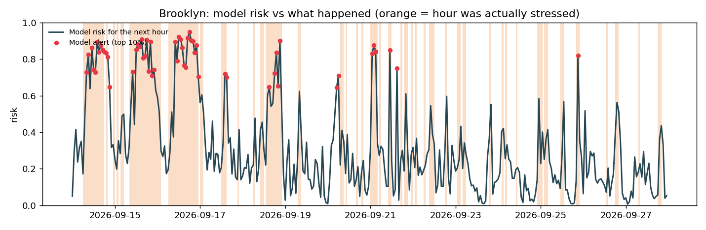

# Results

Generated by `python -m clear.run` on `s390x` in 56 s. Real FDNY data.

## Data

6,065,090 raw rows → 6,065,043 calls, 2023-01-01 → 2026-09-30.
Held calls: 19.8%. Median dispatch wait: held 506 s vs not held 23 s;
high-acuity 23 s vs low-acuity 37 s.

| Split | From | To | Borough-hours | Share stressed |
|---|---|---|---|---|
| train | 2023-01-29 | 2025-06-30 | 93,135 | 26.7% |
| validation | 2025-07-01 | 2025-12-31 | 19,421 | 27.3% |
| test | 2026-01-01 | 2026-09-30 | 28,777 | 26.7% |

## Test months: every method, same alert budget (top 10% of hours)

| Method | PR-AUC (95% CI) | Alert precision | Alert recall | Onset recall | False alerts / day |
|---|---|---|---|---|---|
| Usual for this hour (history) | 0.267 (0.248–0.287) | 0.27 | 0.10 | 0.10 | 7.77 |
| Stressed now -> stressed next (rule) | 0.367 (0.341–0.389) | 0.48 | 0.17 | 0.00 | 5.27 |
| Queue length only (logistic) | 0.445 (0.413–0.474) | 0.50 | 0.32 | 0.26 | 9.17 |
| Call volume only (trees) | 0.476 (0.447–0.503) | 0.58 | 0.24 | 0.18 | 4.88 |
| Full model (trees, 20 inputs) | 0.596 (0.564–0.620) | 0.68 | 0.33 | 0.10 | 4.24 |

## Which inputs the full model relies on (test months)

How much PR-AUC drops when one input is shuffled. Bigger = more important.

| input | PR-AUC drop when shuffled |
|---|---|
| low_dispatch_vs_usual | 0.160 |
| pending_low | 0.125 |
| usual_calls_this_hour | 0.063 |
| calls_last_1h | 0.056 |
| recent_low_dispatch_s | 0.051 |
| held_pending_low | 0.026 |
| stressed_now | 0.011 |
| calls_last_3h | 0.005 |
| hour_of_day | 0.004 |
| borough_code | 0.004 |

## How a label is decided (real numbers)

**Brooklyn, Fri 2026-09-11 20:00–21:00**

| | |
|---|---|
| Same hour, previous 8 weeks (median low-acuity dispatch wait, s) | 190, 64, 16, 26, 29, 27, 281, 136 |
| Threshold = 80th percentile of those | 168 s |
| This hour (37 low-acuity calls) | 115 s |
| Answer | **normal (0)** |

**Brooklyn, Fri 2026-09-18 20:00–21:00**

| | |
|---|---|
| Same hour, previous 8 weeks (median low-acuity dispatch wait, s) | 64, 16, 26, 29, 27, 281, 136, 115 |
| Threshold = 80th percentile of those | 128 s |
| This hour (39 low-acuity calls) | 889 s |
| Answer | **STRESSED (1)** |

**Brooklyn, Fri 2026-09-25 20:00–21:00**

| | |
|---|---|
| Same hour, previous 8 weeks (median low-acuity dispatch wait, s) | 16, 26, 29, 27, 281, 136, 115, 889 |
| Threshold = 80th percentile of those | 223 s |
| This hour (40 low-acuity calls) | 848 s |
| Answer | **STRESSED (1)** |

## Hour by hour: model vs rule vs what happened (test months, real)

### Caught: a new episode starts, the model warned, the rule could not

Brooklyn, around Sun 2026-07-05 07:00 (◀ = the hour in question)

| Hour T | Waiting low-acuity (held) | Waiting > 10 min | Units at hospital | Rule: stressed now? | Model risk | Model alert | Actual median wait (s) | Threshold (s) | **Actual** |
|---|---|---|---|---|---|---|---|---|---|
| Sun 07-05 03:00 | 66 (43) | 64 | 15 | no | 76% | 🔴 | 735 | 482 | **STRESSED** |
| Sun 07-05 04:00 | 62 (45) | 60 | 14 | yes | 94% | 🔴 | 180 | 246 | normal |
| Sun 07-05 05:00 | 57 (42) | 57 | 15 | yes | 95% | 🔴 | 283 | 162 | **STRESSED** |
| Sun 07-05 06:00 | 48 (42) | 44 | 12 | no | 71% | 🔴 | 55 | 63 | normal |
| Sun 07-05 07:00 ◀ | 54 (51) | 53 | 10 | no | 91% | 🔴 | 418 | 32 | **STRESSED** |
| Sun 07-05 08:00 | 53 (50) | 51 | 17 | yes | 92% | 🔴 | 412 | 26 | **STRESSED** |
| Sun 07-05 09:00 | 56 (53) | 53 | 15 | yes | 92% | 🔴 | 876 | 21 | **STRESSED** |
| Sun 07-05 10:00 | 35 (35) | 33 | 13 | yes | 77% | 🔴 | 134 | 22 | **STRESSED** |
| Sun 07-05 11:00 | 24 (24) | 22 | 19 | yes | 90% | 🔴 | 54 | 38 | **STRESSED** |
| Sun 07-05 12:00 | 2 (1) | 1 | 20 | yes | 66% | 🔴 | 33 | 34 | normal |

Briefing at ◀: _Brooklyn Sun 07:00 — stress risk next hour 91% (ALERT). Waiting for a unit now: 54 low-acuity (51 held), 0 high-acuity; 53 waiting > 10 min; 10 units at hospitals. Last hour low-acuity dispatch median 1.0 min (2.0x usual). Suggest: prepare cross-borough support / reserve units; a supervisor decides._

### Missed: a new episode starts, the model stayed quiet

Brooklyn, around Mon 2026-02-23 18:00 (◀ = the hour in question)

| Hour T | Waiting low-acuity (held) | Waiting > 10 min | Units at hospital | Rule: stressed now? | Model risk | Model alert | Actual median wait (s) | Threshold (s) | **Actual** |
|---|---|---|---|---|---|---|---|---|---|
| Mon 02-23 14:00 | 3 (3) | 3 | 29 | no | 18% | · | 27 | 649 | normal |
| Mon 02-23 15:00 | 4 (3) | 2 | 28 | no | 22% | · | 99 | 647 | normal |
| Mon 02-23 16:00 | 7 (6) | 5 | 23 | no | 12% | · | 185 | 850 | normal |
| Mon 02-23 17:00 | 10 (9) | 4 | 22 | no | 24% | · | 208 | 837 | normal |
| Mon 02-23 18:00 ◀ | 11 (9) | 6 | 26 | no | 16% | · | 2976 | 548 | **STRESSED** |
| Mon 02-23 19:00 | 37 (29) | 31 | 18 | yes | 94% | 🔴 | 1401 | 321 | **STRESSED** |
| Mon 02-23 20:00 | 30 (21) | 29 | 17 | yes | 67% | 🔴 | 423 | 38 | **STRESSED** |
| Mon 02-23 21:00 | 22 (11) | 20 | 17 | yes | 54% | · | 267 | 29 | **STRESSED** |
| Mon 02-23 22:00 | 9 (9) | 8 | 26 | yes | 63% | · | 17 | 37 | normal |
| Mon 02-23 23:00 | 0 (0) | 0 | 23 | no | 29% | · | 89 | 35 | **STRESSED** |

Briefing at ◀: _Brooklyn Mon 18:00 — stress risk next hour 16% (normal). Waiting for a unit now: 11 low-acuity (9 held), 2 high-acuity; 6 waiting > 10 min; 26 units at hospitals. Last hour low-acuity dispatch median 3.5 min (2.1x usual). Suggest: no action._

### False alarm: the model warned, the hour stayed normal

Brooklyn, around Sun 2026-06-14 02:00 (◀ = the hour in question)

| Hour T | Waiting low-acuity (held) | Waiting > 10 min | Units at hospital | Rule: stressed now? | Model risk | Model alert | Actual median wait (s) | Threshold (s) | **Actual** |
|---|---|---|---|---|---|---|---|---|---|
| Sat 06-13 22:00 | 12 (8) | 5 | 32 | yes | 82% | 🔴 | 1686 | 728 | **STRESSED** |
| Sat 06-13 23:00 | 19 (17) | 17 | 24 | no | 78% | 🔴 | 142 | 1148 | normal |
| Sun 06-14 00:00 | 13 (11) | 12 | 17 | no | 43% | · | 624 | 379 | **STRESSED** |
| Sun 06-14 01:00 | 34 (28) | 28 | 22 | no | 92% | 🔴 | 334 | 508 | normal |
| Sun 06-14 02:00 ◀ | 47 (39) | 45 | 21 | no | 92% | 🔴 | 126 | 171 | normal |
| Sun 06-14 03:00 | 40 (34) | 35 | 16 | no | 85% | 🔴 | 114 | 258 | normal |
| Sun 06-14 04:00 | 35 (32) | 30 | 11 | yes | 89% | 🔴 | 68 | 434 | normal |
| Sun 06-14 05:00 | 30 (27) | 30 | 20 | no | 68% | 🔴 | 333 | 96 | **STRESSED** |
| Sun 06-14 06:00 | 21 (20) | 19 | 15 | yes | 89% | 🔴 | 346 | 42 | **STRESSED** |
| Sun 06-14 07:00 | 7 (5) | 5 | 19 | yes | 63% | · | 33 | 27 | **STRESSED** |

Briefing at ◀: _Brooklyn Sun 02:00 — stress risk next hour 92% (ALERT). Waiting for a unit now: 47 low-acuity (39 held), 1 high-acuity; 45 waiting > 10 min; 21 units at hospitals. Last hour low-acuity dispatch median 4.9 min (6.1x usual). Suggest: prepare cross-borough support / reserve units; a supervisor decides._

