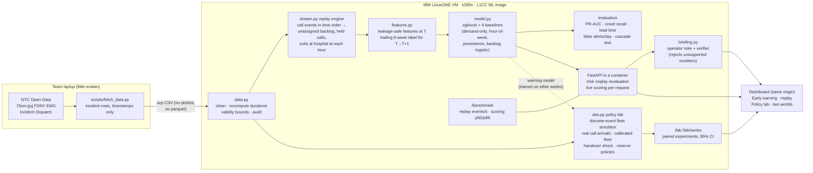

# RescueNYC — Architecture

Everything right of the laptop runs on the team's IBM LinuxONE Community Cloud VM (s390x).

## Why each piece is where it is

| Choice | Reason |
|---|---|
| Train, score, replay and simulate on the VM | The AI/ML work judged under criterion 3 actually runs on LinuxONE; the dashboard shows `computed_on: s390x` from the live API |
| Only CSV crosses from laptop to VM; models saved as xgboost JSON | s390x is big-endian; pickles and some binary formats don't transfer safely |
| Packages from the L1CC ML image (pandas, scikit-learn, xgboost) | PyPI has no s390x wheels for pandas; no source builds during the event |
| One container, one port, dashboard served by the API | One team VM; port exposure may be limited (SSH tunnel fallback works the same) |
| Replay engine is the single source of backlog features | Batch training features and live scoring use the same code, so they cannot drift |
| Policy lab uses real arrivals but a SCENARIO fleet | Public data has no unit availability; fleet is calibrated to observed dispatch waits and labeled as an assumption |
| Only aggregates leave the VM; the briefing never sees row-level data | Privacy by architecture for 911-adjacent data |
