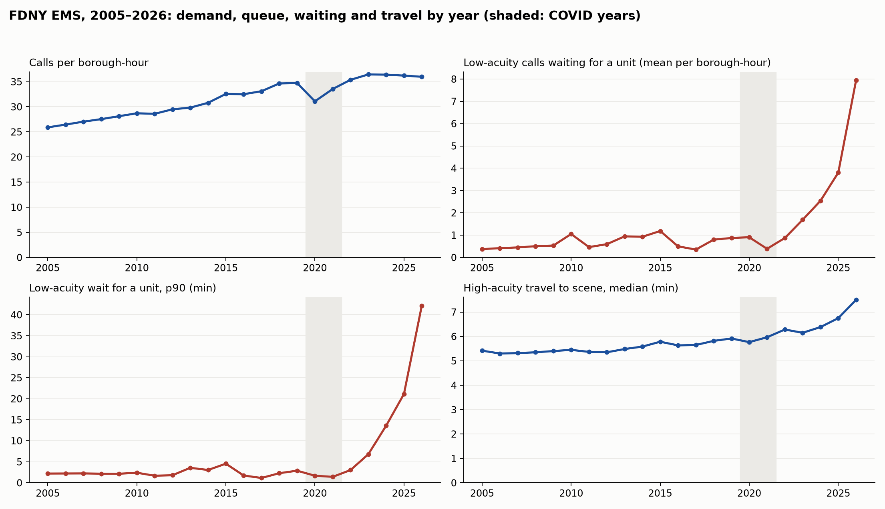

# RescueNYC — Long-run audit, 2005 → 2026
Generated by `scripts/long_run_audit.py` from FDNY EMS Incident Dispatch Data (NYC Open Data 76xm-jjuj), one year at a time with the same cleaning as the pipeline (reopened, transfer and standby rows dropped; durations recomputed from timestamps). Queue columns come from the replay engine: calls created but not yet assigned at each hour. 2020–2021 are the COVID years and should be read as a regime of their own. High acuity = severity 1–3.
## Volume and mix
| year | months | rows_clean | calls_per_borough_hour | high_share | held_share_all | held_share_low |
|---|---|---|---|---|---|---|
| 2005 | 12 | 1,134,594 | 25.9 | 33.1% | 3.4% | 4.8% |
| 2006 | 12 | 1,158,865 | 26.5 | 33.9% | 4.2% | 6.1% |
| 2007 | 12 | 1,184,520 | 27.0 | 35.1% | 5.6% | 8.1% |
| 2008 | 12 | 1,209,628 | 27.5 | 34.9% | 5.8% | 8.5% |
| 2009 | 12 | 1,232,146 | 28.1 | 33.9% | 5.9% | 8.6% |
| 2010 | 12 | 1,257,489 | 28.7 | 35.4% | 6.5% | 9.5% |
| 2011 | 12 | 1,252,847 | 28.6 | 35.7% | 4.9% | 7.4% |
| 2012 | 12 | 1,295,734 | 29.5 | 32.1% | 5.7% | 8.3% |
| 2013 | 12 | 1,306,757 | 29.8 | 31.7% | 9.1% | 13.1% |
| 2014 | 12 | 1,348,934 | 30.8 | 32.6% | 8.5% | 12.4% |
| 2015 | 12 | 1,426,385 | 32.6 | 36.0% | 9.8% | 15.0% |
| 2016 | 12 | 1,427,915 | 32.5 | 36.0% | 4.1% | 6.2% |
| 2017 | 12 | 1,449,949 | 33.1 | 35.8% | 3.0% | 4.4% |
| 2018 | 12 | 1,517,851 | 34.7 | 35.0% | 6.7% | 9.6% |
| 2019 | 12 | 1,521,343 | 34.7 | 34.6% | 7.9% | 11.5% |
| 2020 | 12 | 1,365,433 | 31.1 | 36.9% | 4.7% | 6.7% |
| 2021 | 12 | 1,469,395 | 33.5 | 36.3% | 3.3% | 4.4% |
| 2022 | 12 | 1,549,440 | 35.4 | 36.9% | 7.4% | 10.3% |
| 2023 | 12 | 1,596,406 | 36.4 | 36.9% | 12.8% | 18.8% |
| 2024 | 12 | 1,598,748 | 36.4 | 38.1% | 17.7% | 25.7% |
| 2025 | 12 | 1,586,324 | 36.2 | 37.9% | 21.3% | 30.9% |
| 2026 | 9 | 1,178,736 | 36.0 | 37.7% | 30.2% | 43.0% |

## Waiting for a unit (dispatch, minutes)
| year | dispatch_high_med_min | dispatch_high_p90_min | dispatch_low_med_min | dispatch_low_p90_min |
|---|---|---|---|---|
| 2005 | 0.53 | 1.48 | 0.60 | 2.20 |
| 2006 | 0.52 | 1.42 | 0.57 | 2.22 |
| 2007 | 0.47 | 1.33 | 0.52 | 2.23 |
| 2008 | 0.45 | 1.25 | 0.50 | 2.17 |
| 2009 | 0.43 | 1.20 | 0.50 | 2.15 |
| 2010 | 0.47 | 1.28 | 0.55 | 2.40 |
| 2011 | 0.38 | 1.02 | 0.43 | 1.68 |
| 2012 | 0.38 | 0.97 | 0.43 | 1.80 |
| 2013 | 0.38 | 1.00 | 0.45 | 3.57 |
| 2014 | 0.38 | 1.00 | 0.45 | 3.05 |
| 2015 | 0.38 | 1.02 | 0.47 | 4.55 |
| 2016 | 0.40 | 1.00 | 0.45 | 1.73 |
| 2017 | 0.28 | 0.80 | 0.28 | 1.15 |
| 2018 | 0.32 | 1.00 | 0.33 | 2.28 |
| 2019 | 0.32 | 1.03 | 0.35 | 2.88 |
| 2020 | 0.30 | 0.97 | 0.30 | 1.68 |
| 2021 | 0.30 | 0.92 | 0.30 | 1.42 |
| 2022 | 0.32 | 1.08 | 0.35 | 3.03 |
| 2023 | 0.35 | 1.22 | 0.45 | 6.80 |
| 2024 | 0.38 | 1.33 | 0.55 | 13.58 |
| 2025 | 0.40 | 1.40 | 0.63 | 21.13 |
| 2026 | 0.47 | 1.75 | 1.13 | 42.13 |

## On the road and total response, high acuity (minutes)
| year | travel_high_med_min | travel_high_p90_min | response_high_med_min | response_high_p90_min |
|---|---|---|---|---|
| 2005 | 5.42 | 9.53 | 6.13 | 10.45 |
| 2006 | 5.30 | 9.37 | 5.98 | 10.23 |
| 2007 | 5.32 | 9.42 | 5.97 | 10.23 |
| 2008 | 5.35 | 9.38 | 5.95 | 10.17 |
| 2009 | 5.40 | 9.45 | 5.98 | 10.18 |
| 2010 | 5.45 | 9.57 | 6.08 | 10.38 |
| 2011 | 5.37 | 9.28 | 5.87 | 9.92 |
| 2012 | 5.35 | 9.10 | 5.83 | 9.72 |
| 2013 | 5.48 | 9.38 | 6.00 | 10.03 |
| 2014 | 5.58 | 9.55 | 6.08 | 10.18 |
| 2015 | 5.78 | 9.97 | 6.30 | 10.62 |
| 2016 | 5.63 | 9.67 | 6.13 | 10.28 |
| 2017 | 5.65 | 9.67 | 6.03 | 10.15 |
| 2018 | 5.82 | 10.08 | 6.28 | 10.68 |
| 2019 | 5.92 | 10.32 | 6.38 | 10.90 |
| 2020 | 5.77 | 10.12 | 6.20 | 10.72 |
| 2021 | 5.97 | 10.35 | 6.40 | 10.90 |
| 2022 | 6.28 | 11.12 | 6.77 | 11.78 |
| 2023 | 6.15 | 10.92 | 6.68 | 11.65 |
| 2024 | 6.38 | 11.53 | 6.95 | 12.37 |
| 2025 | 6.75 | 12.30 | 7.33 | 13.18 |
| 2026 | 7.50 | 13.90 | 8.22 | 15.07 |

## Hospital handover proxy
| year | hosp_arrival_share | hosp_to_close_med_min | hosp_to_close_p90_min | at_hospital_mean |
|---|---|---|---|---|
| 2005 | 70.0% | 27.9 | 43.1 | 9.0 |
| 2006 | 71.1% | 28.3 | 43.1 | 9.4 |
| 2007 | 72.3% | 28.7 | 42.7 | 9.8 |
| 2008 | 72.1% | 28.5 | 41.5 | 9.8 |
| 2009 | 71.5% | 29.9 | 42.8 | 10.3 |
| 2010 | 71.1% | 30.5 | 43.2 | 10.7 |
| 2011 | 72.1% | 30.3 | 42.4 | 10.7 |
| 2012 | 71.5% | 30.2 | 41.8 | 10.8 |
| 2013 | 70.9% | 31.9 | 45.6 | 11.8 |
| 2014 | 71.1% | 32.4 | 45.8 | 12.7 |
| 2015 | 70.5% | 33.7 | 47.5 | 13.6 |
| 2016 | 71.1% | 34.0 | 47.6 | 13.5 |
| 2017 | 70.3% | 34.5 | 47.4 | 13.7 |
| 2018 | 68.7% | 34.8 | 46.9 | 14.1 |
| 2019 | 68.1% | 36.0 | 47.9 | 14.4 |
| 2020 | 60.2% | 35.5 | 46.5 | 11.2 |
| 2021 | 62.8% | 34.9 | 45.3 | 12.4 |
| 2022 | 61.6% | 37.8 | 49.5 | 14.0 |
| 2023 | 62.3% | 39.9 | 50.9 | 15.3 |
| 2024 | 62.1% | 41.8 | 52.5 | 15.9 |
| 2025 | 59.9% | 41.0 | 51.4 | 14.9 |
| 2026 | 56.7% | 42.3 | 52.5 | 14.5 |

## Reconstructed queue (mean per borough-hour)
| year | pending_low_mean | pending_low_p90 | pending_high_mean |
|---|---|---|---|
| 2005 | 0.37 | 1.00 | 0.11 |
| 2006 | 0.42 | 1.00 | 0.11 |
| 2007 | 0.45 | 1.00 | 0.10 |
| 2008 | 0.50 | 1.00 | 0.10 |
| 2009 | 0.53 | 1.00 | 0.10 |
| 2010 | 1.05 | 2.00 | 0.18 |
| 2011 | 0.46 | 1.00 | 0.10 |
| 2012 | 0.59 | 1.00 | 0.09 |
| 2013 | 0.94 | 2.00 | 0.09 |
| 2014 | 0.93 | 2.00 | 0.10 |
| 2015 | 1.18 | 3.00 | 0.11 |
| 2016 | 0.50 | 1.00 | 0.11 |
| 2017 | 0.35 | 1.00 | 0.08 |
| 2018 | 0.80 | 2.00 | 0.10 |
| 2019 | 0.87 | 2.00 | 0.10 |
| 2020 | 0.91 | 1.00 | 0.10 |
| 2021 | 0.39 | 1.00 | 0.09 |
| 2022 | 0.87 | 2.00 | 0.12 |
| 2023 | 1.69 | 5.00 | 0.13 |
| 2024 | 2.54 | 8.00 | 0.15 |
| 2025 | 3.80 | 12.00 | 0.16 |
| 2026 | 7.95 | 25.00 | 0.21 |

## Severity code set per year (raw counts)
| year | 0 | 1 | 2 | 3 | 4 | 5 | 6 | 7 | 8 | 9 |
|---|---|---|---|---|---|---|---|---|---|---|
| 2005 | 0 | 19,727 | 242,291 | 113,233 | 242,776 | 223,248 | 211,504 | 81,879 | 6,166 | 9 |
| 2006 | 0 | 19,783 | 248,842 | 124,770 | 247,884 | 227,266 | 204,233 | 86,107 | 5,668 | 19 |
| 2007 | 0 | 18,343 | 246,540 | 150,657 | 254,425 | 231,171 | 195,234 | 88,056 | 5,518 | 11 |
| 2008 | 0 | 17,996 | 249,958 | 154,880 | 258,478 | 234,539 | 204,846 | 88,819 | 6,135 | 17 |
| 2009 | 0 | 17,611 | 237,477 | 162,194 | 271,312 | 237,163 | 213,697 | 92,649 | 5,140 | 23 |
| 2010 | 0 | 17,803 | 243,972 | 183,217 | 276,210 | 245,457 | 196,527 | 94,080 | 5,172 | 41 |
| 2011 | 0 | 17,994 | 245,423 | 184,185 | 280,518 | 235,397 | 191,771 | 97,220 | 4,562 | 10 |
| 2012 | 1 | 16,753 | 251,033 | 148,822 | 335,656 | 236,548 | 202,372 | 104,475 | 4,482 | 16 |
| 2013 | 0 | 16,740 | 251,317 | 146,032 | 245,245 | 279,784 | 252,053 | 115,372 | 3,846 | 7 |
| 2014 | 0 | 18,548 | 261,024 | 159,713 | 254,363 | 278,920 | 253,006 | 123,026 | 4,870 | 17 |
| 2015 | 0 | 22,732 | 303,839 | 187,734 | 272,735 | 263,744 | 241,931 | 138,728 | 4,629 | 19 |
| 2016 | 0 | 22,527 | 309,538 | 183,655 | 277,629 | 254,683 | 244,102 | 144,883 | 4,178 | 9 |
| 2017 | 0 | 21,805 | 310,956 | 188,968 | 284,374 | 230,573 | 234,120 | 188,359 | 4,271 | 11 |
| 2018 | 0 | 20,260 | 323,588 | 189,109 | 310,352 | 261,930 | 245,927 | 175,480 | 4,256 | 13 |
| 2019 | 0 | 19,221 | 316,930 | 191,771 | 321,152 | 250,502 | 245,931 | 183,211 | 4,507 | 14 |
| 2020 | 0 | 25,694 | 298,656 | 181,688 | 303,461 | 216,466 | 205,725 | 177,462 | 3,540 | 8 |
| 2021 | 0 | 23,768 | 306,292 | 205,157 | 325,100 | 234,011 | 199,901 | 193,263 | 3,955 | 6 |
| 2022 | 0 | 24,148 | 326,809 | 222,587 | 335,507 | 267,581 | 208,562 | 194,108 | 4,209 | 14 |
| 2023 | 0 | 23,713 | 336,126 | 231,869 | 335,822 | 277,658 | 216,867 | 191,451 | 4,322 | 5 |
| 2024 | 0 | 24,771 | 346,649 | 239,418 | 257,212 | 362,883 | 203,569 | 191,219 | 4,705 | 14 |
| 2025 | 0 | 23,434 | 349,695 | 230,301 | 221,129 | 396,344 | 187,634 | 198,746 | 4,964 | 19 |
| 2026 | 0 | 16,785 | 257,061 | 172,279 | 171,976 | 303,967 | 145,625 | 132,911 | 3,938 | 9 |

