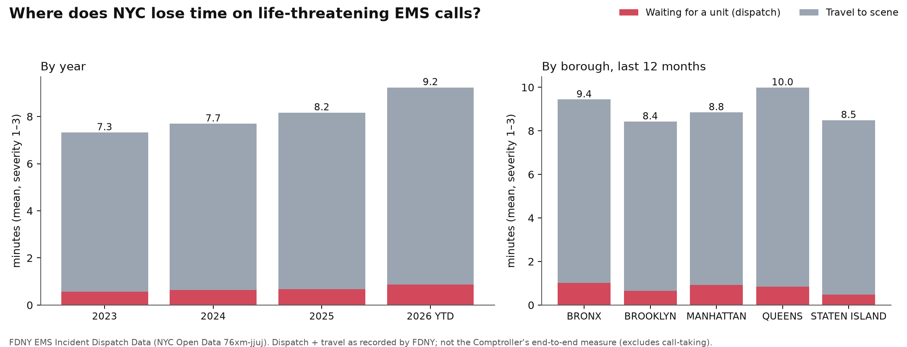

# RescueNYC — Historical EMS performance audit (P0)

## Findings (P0 gate, laptop run 2026-10-17)

Answers to the seven handoff questions, from `docs/check_raw_output.txt` and the sections below.

1. **Missing months:** none. 45 monthly files, 2023-01 → 2026-09, 6,065,090 raw rows (5,960,214 after cleaning).
2. **Published vs recomputed dispatch seconds:** 0.02% differ by more than 1 s (296,437 compared). The timestamp definitions in SPEC §2 are right. 0.35% of recomputed dispatch times exceed 3 h.
3. **Held calls:** held share 19.8%; median dispatch 524 s held vs 22 s not held. check_raw says OK, so the `held_*` backlog features stay.
4. **Severity codes:** codes 1–8 are present in every year with a stable mix; code 9 appears in 17 rows (2024–2025) and is ignored. No year restriction needed.
5. **Where is time lost:** mean high-acuity response rose **+1.91 min** from 2023 to 2026: travel **+1.61 min** (84% of the rise), dispatch +0.30 min. The rule in the Decision section therefore picks **`travel`** as the label target. Caveat recorded for the model step: dispatch is far more variable hour to hour (CV 0.87 vs 0.24 for travel), and high-acuity dispatch medians are under 30 s, so the queue-stress signal shows up mainly in low-acuity dispatch (severity 4–7 p90 dispatch 21–54 min, held share 35–56%).
6. **Volume vs delay:** Spearman rho between a borough-hour's call volume and its median high-acuity dispatch time is 0.40; within the same volume decile the slowest 10% of hours are 3.3× the fastest 10%. Demand explains part of the delay, not most of it.
7. **Latest incident:** 2026-09-30 23:51. The test window 2026-01-01 → 2026-09-30 is nine months long; `--test-start 2026-01-01` stays.
8. **Is stress local or citywide? (added Oct 17 evening, 2026 test window, low-acuity label):** of 4,381
   hours with at least one stressed borough, 49% have exactly one, 31% two, and 0.7% all five. When a
   borough is stressed, in 80–85% of those hours another borough is holding zero low-acuity calls
   (Staten Island 50%). Pressure is mostly local and slack usually exists elsewhere, which is the
   premise for an hour-ahead warning that supports cross-borough resource decisions.
9. **Is the travel rise just traffic? Partly not.** Within the same borough and hour of week (Oct 2025 →
   Sep 2026), high-acuity travel medians are 7.06 min when the low-acuity queue is in its lowest third
   and 7.74 min in its highest third (+10%); +7% by last-hour call volume; only +2% by units at hospital.
   Roads do not slow down because the EMS queue is long, so part of the travel rise is farther units
   being sent when the nearest are busy: a capacity and turnaround effect, not only congestion.
10. **Demand is flat, the queue is not.** Mean calls per borough-hour: 36.4 (2023), 36.4, 36.2, 36.0
   (2026). Mean units at hospital: 15.3 → 14.5. Mean low-acuity calls waiting for a unit: **1.7 → 2.5 →
   3.8 → 8.0**. With demand and hospital load flat, the queue grew 4.7×, which points at available unit
   capacity or longer unit cycles, consistent with the Council's "volume flat, response up" finding.
11. **The low-acuity queue contains patients who turn out to be high-acuity.** 2026 Jan–Sep (API count,
   `final_severity_level_code` used for this audit line only, never as a feature): 758,417 calls were
   triaged severity 4–8 at call-taking; 59,149 of them (7.8%) were re-graded to severity 1–3 on scene,
   and 52.3% of those had been held for lack of a unit (42.9% of all low-acuity calls were held). No
   causal claim; it quantifies who is in the queue.
12. **Slow ambulances, normal roads.** With NYC DOT road speeds added (2026 test window, hourly), 16.5% of
   borough-hours show travel pressure; 12.8% with roads within 10% of their norm ("units far") and 3.7% with
   roads clearly slower ("roads"). Next-hour stress rate: normal 0.23, units far 0.34, roads 0.42, dispatch
   pressure 0.41, both 0.54. Three in four slow-travel hours are a coverage problem, not congestion. Adding
   road speed, call-type mix and weather to the model left PR-AUC unchanged (0.567 both ways): they explain,
   they do not predict the queue.
13. **Twenty-one years in one line (`docs/long_run_audit.md`, 2005 → 2026, 28.6 M calls).** Calls per
   borough-hour rose from 25.8 (2005) to 34.8 (2019), +35%, while the reconstructed low-acuity queue stayed
   between 0.4 and 1.2 calls per borough-hour and the low-acuity p90 wait between 1 and 4.5 minutes: capacity
   kept pace with demand for seventeen years. After 2022 demand is flat (35–36) and the queue goes 0.9 → 1.7 →
   2.5 → 3.8 → 8.0, the p90 wait 3 → 7 → 14 → 21 → 42 minutes, held share 7% → 30%. High-acuity travel median
   drifted 5.4 → 5.9 min over 2005–2019, then 6.0 → 7.5 over 2021–2026. Severity codes 1–8 are present in every
   year. Whatever changed, it changed after 2022 and it was not the number of calls.

Generated by `scripts/performance_audit.py`. 5,960,214 calls, 2023-01-01 → 2026-09-30; severity 1–3 = 2,244,123. This measures FDNY's historical operational performance from public records; it is not an accuracy score for FDNY's CAD, whose internal predictions and unit states are not public. Dispatch + travel as FDNY records them, not the Comptroller's end-to-end time.

## 1. High-acuity (severity 1–3) by year (minutes)

| year | calls | dispatch_med | dispatch_p90 | travel_med | travel_p90 | response_med | response_p90 | response_p95 | held_share |
| --- | --- | --- | --- | --- | --- | --- | --- | --- | --- |
| 2023 | 589723 | 0.35 | 1.22 | 6.15 | 10.92 | 6.68 | 11.65 | 13.73 | 0.02 |
| 2024 | 608622 | 0.38 | 1.33 | 6.38 | 11.53 | 6.95 | 12.37 | 14.73 | 0.04 |
| 2025 | 601388 | 0.40 | 1.40 | 6.75 | 12.30 | 7.33 | 13.18 | 15.80 | 0.05 |
| 2026 | 444390 | 0.47 | 1.75 | 7.50 | 13.90 | 8.22 | 15.07 | 18.18 | 0.09 |

## 2. Where did the added time come from?

Mean high-acuity response changed by **+1.91 min** from 2023 to 2026: dispatch +0.30 min, travel +1.61 min (dispatch = 16% of the change; calls with both stages valid).

## 3. By borough, last 12 months (severity 1–3, minutes)

| borough | calls | dispatch_med | dispatch_p90 | travel_med | travel_p90 | response_med | response_p90 | response_p95 | held_share |
| --- | --- | --- | --- | --- | --- | --- | --- | --- | --- |
| BRONX | 143289 | 0.57 | 2.05 | 7.65 | 13.70 | 8.53 | 15.02 | 17.82 | 0.09 |
| BROOKLYN | 160612 | 0.37 | 1.38 | 7.08 | 12.57 | 7.68 | 13.43 | 16.03 | 0.06 |
| MANHATTAN | 142554 | 0.47 | 1.72 | 6.98 | 13.42 | 7.72 | 14.63 | 17.82 | 0.11 |
| QUEENS | 119393 | 0.47 | 1.75 | 8.15 | 15.57 | 8.88 | 16.73 | 20.22 | 0.09 |
| RICHMOND / STATEN ISLAND | 26317 | 0.25 | 0.83 | 7.27 | 12.94 | 7.63 | 13.61 | 16.58 | 0.06 |

## 4. By severity, last 12 months (all calls, minutes)

If low-acuity calls wait far longer and are held more, the queue absorbs pressure there first (the severity-cascade hypothesis).

| severity | calls | dispatch_med | dispatch_p90 | travel_med | travel_p90 | response_med | response_p90 | response_p95 | held_share |
| --- | --- | --- | --- | --- | --- | --- | --- | --- | --- |
| 1 | 22472 | 0.42 | 1.07 | 5.58 | 9.93 | 6.12 | 10.60 | 12.67 | 0.13 |
| 2 | 341864 | 0.43 | 1.62 | 7.45 | 13.68 | 8.12 | 14.72 | 17.67 | 0.09 |
| 3 | 227829 | 0.47 | 1.88 | 7.57 | 14.00 | 8.33 | 15.30 | 18.52 | 0.08 |
| 4 | 224721 | 0.82 | 21.53 | 9.78 | 22.82 | 12.80 | 43.48 | 65.93 | 0.35 |
| 5 | 399645 | 0.90 | 40.03 | 9.70 | 22.55 | 13.60 | 61.80 | 95.54 | 0.38 |
| 6 | 176686 | 0.93 | 54.33 | 9.97 | 23.15 | 14.70 | 83.30 | 130.32 | 0.39 |
| 7 | 178789 | 2.32 | 44.98 | 12.73 | 29.73 | 18.63 | 73.97 | 115.65 | 0.56 |
| 8 | 643 | 1.12 | 28.29 | 9.05 | 19.87 | 12.18 | 50.48 | 80.37 | 0.42 |
| 9 | 14 | 0.00 | 0.01 | 0.00 | 0.00 | 0.00 | 0.01 | 0.22 | 0.07 |

## 5. Is delay just demand?

Spearman rank correlation between a borough-hour's call volume and its median high-acuity dispatch time: **0.40**. Within the same volume decile (relative to each borough's mean), the slowest 10% of hours are a median **3.3×** the fastest 10%. Volume alone leaves most of the variation unexplained, which is what the queue state is meant to capture.

| decile | rel_volume | median_dispatch_min | p10_min | p90_min | p90_over_p10 |
| --- | --- | --- | --- | --- | --- |
| 0 | 0.43 | 0.28 | 0.16 | 0.57 | 3.63 |
| 1 | 0.59 | 0.31 | 0.18 | 0.58 | 3.18 |
| 2 | 0.73 | 0.32 | 0.18 | 0.62 | 3.36 |
| 3 | 0.86 | 0.33 | 0.18 | 0.62 | 3.36 |
| 4 | 0.97 | 0.35 | 0.20 | 0.65 | 3.25 |
| 5 | 1.08 | 0.36 | 0.20 | 0.67 | 3.33 |
| 6 | 1.16 | 0.42 | 0.25 | 0.72 | 2.87 |
| 7 | 1.26 | 0.40 | 0.22 | 0.72 | 3.31 |
| 8 | 1.37 | 0.43 | 0.23 | 0.75 | 3.21 |
| 9 | 1.59 | 0.42 | 0.20 | 0.79 | 3.96 |

## 6. When is the unassigned backlog largest?

| hour_of_day | pending_high | pending_low | held_pending_low |
| --- | --- | --- | --- |
| 0 | 0.12 | 2.32 | 1.96 |
| 1 | 0.11 | 2.05 | 1.73 |
| 2 | 0.10 | 1.87 | 1.58 |
| 3 | 0.08 | 1.75 | 1.51 |
| 4 | 0.07 | 1.57 | 1.36 |
| 5 | 0.06 | 1.44 | 1.25 |
| 6 | 0.07 | 1.42 | 1.23 |
| 7 | 0.08 | 1.49 | 1.32 |
| 8 | 0.11 | 1.61 | 1.39 |
| 9 | 0.12 | 1.97 | 1.71 |
| 10 | 0.15 | 2.21 | 1.90 |
| 11 | 0.17 | 2.50 | 2.12 |
| 12 | 0.20 | 3.01 | 2.53 |
| 13 | 0.22 | 3.95 | 3.37 |
| 14 | 0.24 | 4.61 | 3.93 |
| 15 | 0.24 | 5.75 | 4.93 |
| 16 | 0.24 | 7.04 | 6.08 |
| 17 | 0.23 | 7.88 | 6.84 |
| 18 | 0.25 | 8.84 | 7.82 |
| 19 | 0.23 | 9.12 | 8.13 |
| 20 | 0.21 | 6.75 | 5.92 |
| 21 | 0.19 | 4.41 | 3.81 |
| 22 | 0.16 | 3.31 | 2.78 |
| 23 | 0.15 | 2.61 | 2.19 |

Top borough × weekday × hour by mean low-acuity calls waiting:

| borough | dow | hour_of_day | pending_low |
| --- | --- | --- | --- |
| BRONX | Mon | 18 | 22.30 |
| BRONX | Mon | 19 | 21.30 |
| BRONX | Mon | 17 | 20.30 |
| MANHATTAN | Thu | 19 | 20.10 |
| BRONX | Fri | 19 | 20.00 |

## Decision

Recommended label target: **`travel`**, by share of the rise (hour-to-hour CV: dispatch 0.87, travel 0.24). `python scripts/run_pipeline.py --target travel ...`. Rule: predict the stage that accounts for most of the rise in mean high-acuity response; check it against sections 3–5 before committing, and record the choice in PLAN.md.
